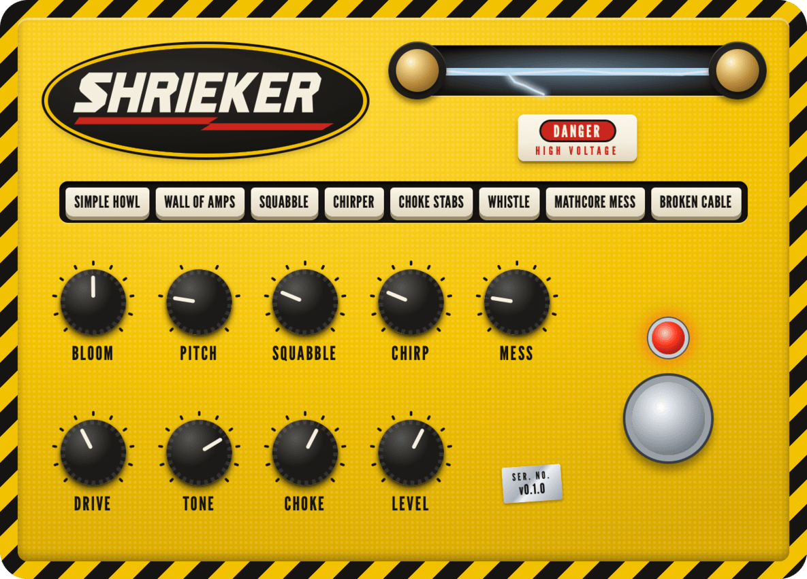

# Shrieker

Guitar feedback that blooms, chirps, squabbles and jumps harmonics.



A VST3 and CLAP plugin for macOS and Windows. It fakes the feedback you
get standing in front of a cranked amp: hold a note and a scream swells
in on one of its harmonics, then chirps, squabbles between pitches or
falls apart, as messy or as simple as you set it.

Put it before your amp or amp sim, so the amp breaks up the feedback the
way it would the real thing.

## How it works

1. A pitch tracker follows the note you're holding, on a downsampled
   copy of the input, so the dry guitar is never delayed.
2. Three loops, each a band-pass at a harmonic of that note feeding a
   soft clipper back into itself, ring in tune like a string in front of
   a loud speaker. Pitch picks the harmonic the main loop sits on.
3. An envelope follower listens to your playing. The feedback swells in
   while a note rings, picking ducks it by Choke, and muting the strings
   cuts it. Once it has fully bloomed it keeps going as the string
   decays.
4. Squabble lets the other two loops, on neighbouring harmonics, steal
   control. Chirp fires pitch swoops on picks and at random. Mess adds
   noise, drift, harder clipping and dropouts.
5. Drive and Tone shape the feedback on its way out, and Level mixes it
   in with the untouched dry guitar.

Everything runs one sample at a time, so the host's buffer size doesn't
change the sound. A lower buffer only cuts the delay you hear.

## Controls

| Control | Range | What it does |
|---|---|---|
| Bloom | 0.05–4 s | How long the feedback takes to swell in on a held note |
| Pitch | Root to 2 Oct + 5th | The harmonic it locks to: Root, Octave, Oct + 5th, 2 Oct, 2 Oct + 3rd or 2 Oct + 5th |
| Squabble | 0–100% | How hard neighbouring harmonics fight for control, and how often they flip |
| Chirp | 0–100% | How often pitch swoops fire and how far they reach, and how slowly the feedback slides between notes |
| Mess | 0–100% | Noise, drift and harder clipping in the loop, with random dropouts above 50% |
| Drive | 0–100% | How hard the feedback is distorted on the way out |
| Tone | 500 Hz–12 kHz | Low-pass on the feedback only |
| Choke | 0–100% | How much picking a note cuts the feedback before it blooms again |
| Level | 0–100% | Feedback volume, on top of the dry guitar |
| Stomp | On / Off | The footswitch. Off fades the feedback out and leaves the dry guitar untouched |

Drag a knob up or down (hold Shift for fine moves), scroll, or use the
arrow keys. Double-click a knob to reset it. Hover over a knob to see
its value. The spark between the electrodes flares with the feedback
you're hearing, and its shape follows Mess, Squabble and Chirp.

The preset keys set every knob but Stomp:

| Preset | Sound |
|---|---|
| Simple Howl | One clean, steady octave howl |
| Wall of Amps | A slow swell on the octave and fifth, a little unstable |
| Squabble | Harmonics fighting and flipping fast |
| Chirper | Lots of pitch swoops up at two octaves |
| Choke Stabs | Every pick cuts it, and it snaps back between stabs |
| Whistle | A high, thin, clean harmonic |
| Mathcore Mess | Everything up: fast bloom, squabbling, chirps and heavy mess |
| Broken Cable | Maximum mess, with dropouts and crackle |

## Tips

- Set Squabble, Chirp and Mess to 0 for one simple, steady howl, then
  bring them up until it misbehaves the way you want.
- Single notes and power chords track best. On dense chords it holds
  the last pitch it found clearly.
- Palm-mute to kill the feedback on cue.
- For stabby riffs, turn Choke up and Bloom down, so each pick cuts the
  feedback and it snaps right back.

## Installing

Download the zip from
[Releases](https://github.com/starzonmyarmz/shrieker/releases/latest)
and follow `INSTALL.txt` inside it. The plugin isn't signed or
notarized, so macOS may need `xattr -dr com.apple.quarantine` on it
first; `INSTALL.txt` has the exact command.

## Building

```sh
cargo xtask bundle shrieker --release     # target/bundled/Shrieker.{vst3,clap}
scripts/install.sh                        # bundle, sign ad hoc and install on macOS as X.Y.Z-dev+<sha>
scripts/clap-validator.sh target/bundled/Shrieker.clap
cargo fmt --all && cargo clippy --workspace --all-targets -- -D warnings
```

Local installs call themselves `X.Y.Z-dev+<sha>` on the panel, so you
can tell which build the host loaded. Only releases change the version.

## Tests

`cargo test` runs the engine offline: a golden render of a held note at
the default settings, plus synthetic tests for the pitch tracker,
blooming on the chosen harmonic, muting, silence, block sizes, the
feedback meter and the footswitch, and checks that every preset fits
the controls. After an intended change to the sound, rerun with
`BLESS=1` to rewrite the renders and `ui/mock.json`, and listen to them
before committing.

## Working on the UI

The editor is a webview showing `ui/index.html`, which is compiled into
the plugin. Without the plugin, the page runs against a mock, so you can
work on it in a browser:

```sh
cd ui && python3 -m http.server 8765    # open http://127.0.0.1:8765
```

Add `?version=1.2.0` to show a version other than `0.0.0`. To load
the page live in the plugin, set `SHRIEKER_UI_URL` to that URL
before starting the host.

## CI and releases

Versions follow [SemVer](https://semver.org), and the commits since the
last release decide the bump:

| Commits since the last release | Bump |
|---|---|
| a `!` or `BREAKING CHANGE:` footer | major (minor before 1.0) |
| `feat` | minor |
| `fix`, `perf`, `revert` | patch |
| anything else | no release |

`scripts/release` shows the computed bump and the changelog, then
commits, tags `vX.Y.Z` and pushes. Pass `patch`, `minor`, `major` or an
exact version to override, and `--dry-run` to only look. It refuses to
release `feat`, `fix` or `perf` commits while `[Unreleased]` in
[CHANGELOG.md](CHANGELOG.md) is empty.

- `check.yml` runs on pushes to main and on PRs: `cargo fmt --check`
  and clippy, the tests and clap-validator on macOS, and clap-validator
  on the Windows build.
- `changelog.yml` runs on PRs and fails when a `feat`, `fix` or `perf`
  commit doesn't touch `CHANGELOG.md`. Add the `no-changelog` label or
  put `[skip changelog]` in the subject to opt out.
- `release.yml` runs on `vX.Y.Z` tags. The tag must match `version` in
  the root `Cargo.toml`. It tests, builds a macOS bundle and a Windows
  bundle, and publishes `shrieker-X.Y.Z.zip` with `INSTALL.txt` and
  `SHA256SUMS`, using the version's changelog section as the release
  notes.
- Nothing on GitHub takes screenshots. `scripts/release` retakes
  `docs/shrieker.png` through `scripts/pre-release.sh` before the
  release commit, so the shot shows the new version. Between releases,
  retake it with `scripts/screenshot.sh` and commit it with the UI
  change it shows.

## Built with

- [nice-plug](https://codeberg.org/RustAudio/nice-plug), pinned to
  [a fork](https://github.com/starzonmyarmz/nice-plug/tree/patina) that
  adds `ActivateContext::gui_context()`.
- [League Gothic](https://github.com/theleagueof/league-gothic) by The
  League of Moveable Type, under the SIL Open Font License (`ui/fonts`).
- Started from
  [project-kit](https://github.com/starzonmyarmz/project-kit).
